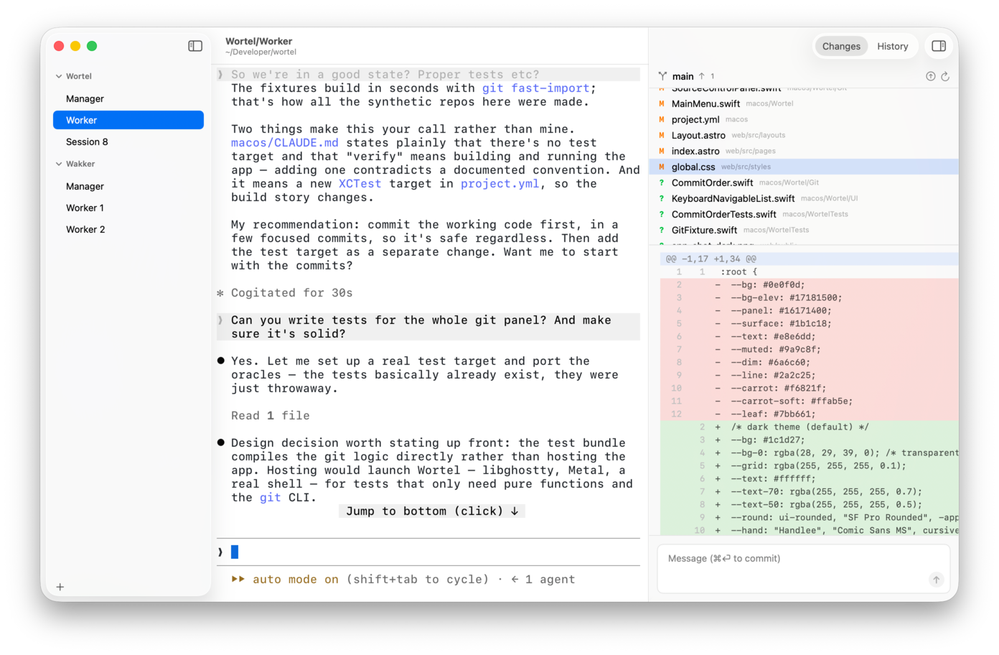

# Wortel

**A native macOS terminal your agents can live in.**

Wortel is a minimal, performance-first macOS terminal built on
[Ghostty](https://ghostty.org)'s real engine. Swift and AppKit, no web view,
nothing bolted underneath. Instead of tabs it has a sidebar of *named* sessions,
each one a shell in its own directory; point it at a repository and each agent
can have its own git worktree, with the diff of what it did sitting beside it.

Shells belong to a helper process rather than to the app, so quitting Wortel
closes a window instead of killing whatever your agents were in the middle of.

<picture>
  <source media="(prefers-color-scheme: dark)" srcset=".github/assets/hero-dark.png">
  
</picture>

*One window: sessions named for what they are, an agent working in one of them,
and the diff of what it changed in the column beside it.*

wortel.sh &middot; [download](https://updates.wortel.sh/Wortel-latest.zip) &middot;
[changelog](https://wortel.sh/updates) &middot; macOS 14 Sonoma or later, free,
signed and notarized

> **Naming.** "wortel" is Dutch for **root**, as in the root of a plant or the
> root shell. That is the intended metaphor, not "carrot". Some landing assets
> still lean on the carrot reading; those are placeholders.

---

## Status and licence

**There is no LICENSE file in this repository yet**, which means the default
applies: all rights reserved, and you may read this code but not fork,
redistribute or build on it. That is an omission rather than an intention and it
is the first thing to fix. Until then, please treat the source as
look-but-do-not-copy.

Third-party dependencies carry their own licences, which are not superseded by
anything here. See [Third-party code](#third-party-code).

---

## Repository layout

Three self-contained deployables. There is no shared build system and no
workspace manager; work in one rarely touches another.

| Directory | What it is | Deploys to |
| --- | --- | --- |
| [`macos/`](macos/) | The app. Swift + XcodeGen. **This is the product.** | Sparkle, via R2 |
| [`web/`](web/README.md) | The landing page. Astro, static. | wortel.sh |
| [`updates/`](updates/README.md) | The Worker serving the appcast and the signed archives. | updates.wortel.sh |

`updates/` is separate from `web/` on purpose. The update channel must not be
able to go down with a bad landing-page build, and `release.sh --publish`
redeploys the landing page at the end of every release. That Worker changes
almost never.

Each directory documents itself. Start with [`macos/CLAUDE.md`](macos/CLAUDE.md)
for the app's architecture and the reasoning behind it: it is the design record,
and it is unusually detailed because most of the decisions in this codebase were
made against a measurement.

---

## Building from source

### Requirements

- macOS 14 (Sonoma) or later to **run**
- **Xcode 26 or later** to build, for the macOS 26 SDK
- [XcodeGen](https://github.com/yonaskolb/XcodeGen): `brew install xcodegen`
- Node 20 or later, only for `web/` and `updates/`

The SDK requirement and the deployment target are deliberately far apart. The
app targets macOS 14 and runs there in full, but it imports `FoundationModels`
for two on-device features (naming a session from what is on its screen, and
drafting a commit message), and that framework only exists in the macOS 26 SDK.
Both are gated behind `@available(macOS 26.0, *)` and an Apple Intelligence
capability check, so on anything older they are simply absent.

**The `.xcodeproj` is generated and gitignored.** `macos/project.yml` is the
source of truth, so a fresh clone has no project file until you make one. This
catches everybody once:

```sh
git clone git@github.com:gielcobben/wortel.git
cd wortel/macos
xcodegen generate
xcodebuild -project Wortel.xcodeproj -scheme Wortel -configuration Debug build
```

Re-run `xcodegen generate` after any change to `project.yml`, and after pulling
a change to it. The first build resolves twenty-odd Swift packages (libghostty,
Sparkle, and one tree-sitter grammar per supported language), so it needs a
network and takes a few minutes; later builds do not.

To run what you just built:

```sh
open "$(xcodebuild -project Wortel.xcodeproj -scheme Wortel -configuration Debug \
  -showBuildSettings 2>/dev/null \
  | awk -F' = ' '/ BUILT_PRODUCTS_DIR /{print $2; exit}')/Wortel.app"
```

Resolve `BUILT_PRODUCTS_DIR` rather than globbing DerivedData. A glob happily
matches several stale build directories and opens all of them.

### A caveat about Debug builds

An ad-hoc-signed Debug build in DerivedData is not registered with macOS's
notification daemon. `UNUserNotificationCenter` will report `granted`, accept
every post without error, and display nothing. If you are working on the
attention system you need a properly signed build in `/Applications`:

```sh
./scripts/release.sh          # signed Release, installed, launched
```

It auto-detects a Developer ID (falling back to Apple Development). Override
with `WORTEL_SIGN_IDENTITY`.

### `web/` and `updates/`

```sh
cd web && npm install && npm run dev        # http://localhost:4321
cd updates && npm install && npm test       # pure logic, no network
```

---

## Tests

```sh
cd macos
xcodebuild -project Wortel.xcodeproj -scheme WortelTests test    # 412 tests, ~85s
cd ../updates && npm test                                        # 16 tests, <1s
```

The Swift target is deliberately **not hosted by the app**: hosting would launch
libghostty, Metal and a real shell in order to test pure functions. `project.yml`
instead lists the individual sources it exercises and compiles them into the test
bundle, which means **a new file needs listing in both targets**.

The bar for a source being testable here is that it works without the app shell,
and that constraint has shaped the code: it is why migration decisions stay out
of types that would drag AppKit in, and why the folder/leaf name split lives in
`SessionName` rather than on `Session`.

Most of these tests **use git itself as the oracle**. The commit ordering and the
graph layout are compared against real `git log --topo-order` and
`git log --graph` output from a fixture repository, because cheaply reproducing
those is the entire point of the code under test. `WortelTests/GitFixture.swift`
explains why its branches are deliberately long-lived: a tamer fixture passes
against known bugs.

There is no UI test coverage. For the app itself, "verify" still means building
it and using it.

### Benchmarks

```sh
cd macos
./bench/measure.sh     # cold launch + memory, Release only
./bench/compare.sh     # throughput against every terminal you have installed
```

Current figures and the method are in
[`macos/bench/BENCHMARKS.md`](macos/bench/BENCHMARKS.md). The short version: the
Release bundle is about 7 MB and cold launch is 55 to 57 ms on Apple silicon (a
Debug build is several times larger and is not what these measure). Because Wortel embeds
Ghostty's VT parser, Metal renderer and glyph atlas, raw throughput is
Ghostty-class by construction; what these checks exist to prove is that the app
shell adds nothing on top.

---

## How the app is put together

One window. One libghostty runtime. A list of sessions, each owning exactly one
terminal surface.

- **`GhosttyRuntime`** owns the single libghostty process state and every C
  callback. Callbacks can arrive on libghostty's IO and render threads; each one
  copies its C-pointer data synchronously and then hops to the main thread.
- **`SurfaceView`** is the NSView hosting one surface, ported from Ghostty.app
  and trimmed. libghostty installs its own IOSurface-backed layer and renders
  from its own thread, so this view only does input forwarding (including the
  full `NSTextInputClient` IME dance) and geometry.
- **`SessionManager`** is the single source of truth for the session list and
  the selection, and the one path that lazily spawns a surface.
- **`TerminalHostViewController`** keeps *every* session's view in the hierarchy
  and switches with `isHidden` and first-responder changes. Nothing is ever
  removed or rebuilt, which is what makes switching instant with no flash.
- **The keeper** (`Wortel/Keeper/`, `WortelKeeper/`) is a small helper process
  that owns the ptys. It knows nothing about terminals, git or rendering: it
  forks what it is told to fork and keeps reading when nobody is attached. Its
  one invariant is that exactly one process reads a pty at a time.

Two rules run through the whole codebase:

**Main thread only**, for everything Wortel owns. Only libghostty's callbacks
cross threads, and they marshal immediately. The telemetry client is the single
deliberate exception, because it is the only thing here that touches the network
and it must never make the terminal wait.

**Cost tracks the window on screen, not the size of the repository.** The
terminal beside the git panel has to stay smooth on a monorepo, so: the commit
log is read in git's cheap default order and re-sorted in-process (asking git for
`--topo-order` makes it walk the entire history before printing a line, measured
at 870 ms against 20 ms, and `--max-count` does not bound it); diffs are parsed
off the main actor and capped; only expanded directories in the file tree are
listed, watched or `check-ignore`d. Each of those looks like a pointless detour
until you measure it on a large repository, and `macos/CLAUDE.md` records the
numbers.

### What Wortel deliberately does not do

These are not gaps waiting to be filled. Returning "unhandled" for them is how
the design is enforced, and pull requests adding them are unlikely to land.

- **No splits.** A session has tabs in three rows (the main area, a side
  column, a strip under the terminal), not a grid of panes; the sidebar of
  named sessions is where you switch work.
- **No settings UI, and no user config.** Wortel is zero-config: the entire
  configuration is the bundled read-only `macos/Resources/wortel.conf`, and your
  real `~/.config/ghostty` is never read. To change fonts, theme or keybinds,
  edit that file and rebuild.
- **No inspector, and no search UI in the terminal.**
- **No per-agent integrations.** The `wortel` command is the whole interface, so
  anything that can run a command can drive the app.

---

## Keyboard

| Keys | Action |
| --- | --- |
| `⌘N` | New session (`⌥⌘N` at home) |
| `⇧⌘N` / `⌘O` | New folder / open folder |
| `⌥⌘R` | Rename session |
| `⌘W` / `⇧⌘W` | Close the tab you are in / close the session |
| `⌘1`…`⌘9` | Select session by position |
| `⇧⌘[` / `⇧⌘]` | Previous / next session (also `⌥⌘↑` / `⌥⌘↓`) |
| `⌥⌘]` | Jump to the next session waiting on you |
| `⌘B` / `⌥⌘B` / `⌘J` | Show or hide the sidebar, the side column, the bottom strip |
| `⇧⌘E` / `⌃⇧G` | Files / source control |
| `⌘T` | New terminal tab in the area you are in |
| `⌘D` / `⇧⌘D` | New terminal in the side column / the bottom strip |
| `⇧⌘L` | New browser tab |
| `⇧⌘T` | Reopen closed tab |
| `⌃Tab` / `⌃⇧Tab` | Next / previous tab (also `⌥⌘→` / `⌥⌘←`) |
| `⌘]` / `⌘[` | Focus the next / previous area |
| `⌘L` / `⌘R` | Browser: address field / reload |
| `⌘F`, `⌘G` | Find in a file, next match |
| `⌘K` | Clear the terminal |
| `⌘+` / `⌘-` / `⌘0` | Font size |
| `⇧⌘A` | Select all (the whole scrollback) |
| `⌘/` | This list |

The full list, and which app each one is borrowed from, is in
[`macos/docs/shortcuts.md`](macos/docs/shortcuts.md).

`⌘A` is deliberately *not* select-all: it is bound in `wortel.conf` to clear the
input line, which is why select-all lives on `⇧⌘A`. The menu is authoritative for
key equivalents (AppKit scans them on every keypress, so it is kept small), and
it interacts with `wortel.conf`'s keybinds. **When adding or moving a shortcut,
check both files.**

With a preview window in front, `⌘1` / `⌘2` / `⌘3` switch it between diff, source
and rendered Markdown. The shortcut physically moves between menus rather than
being duplicated, because `performKeyEquivalent` stops at the first matching item
and swallows the event if that item validates as disabled.

---

## The `wortel` command

A Unix socket the CLI speaks JSON at. **There is nothing to install:** the binary
ships inside the app bundle and every shell Wortel spawns gets its directory on
`PATH`, so the command exists inside a session and nowhere else.

```sh
wortel open README.md                       # preview a file
wortel new --cwd ~/Developer/lijn           # a session there
wortel new --branch fix/1482 --from main    # a session in its own worktree
wortel rename "css rules"                   # rename the session you are in
wortel notify "Build finished"              # raise attention on this session
wortel cd ../new-site                       # move this session, agent and all
```

Two decisions shape it: it **never steals focus** (windows are ordered front, the
app is never activated, so a hook firing behind your back cannot take your
keyboard), and **a command means the session it was run in**, read from
`$WORTEL_SESSION_ID` rather than passed as an argument.

Full guide: [`macos/docs/wortel-command.md`](macos/docs/wortel-command.md).
Design record: [`macos/docs/cli.md`](macos/docs/cli.md).

---

## Releasing

```sh
cd macos
./scripts/release.sh --publish
```

That derives a CalVer version, builds, signs, notarizes, staples, EdDSA-signs a
zip, regenerates the Sparkle appcast, uploads to the `wortel-updates` R2 bucket
and redeploys the landing page. Versions are `<ISO-week-year>.<ISO-week>.<nth
release that week>`, derived from the date, so there is no version to choose.

**Publishing requires a release note.** One Markdown file per release in
`web/src/content/releases/`, *named for the version* (`2026.33.1.md`). It is the
only place release notes are written and it feeds both the public changelog and
the notes Sparkle embeds in the in-app update dialog. The check runs before
anything is built.

Note `--no-install`, which exists for a specific hazard: the install step quits
Wortel, and a release is often cut from a shell running inside Wortel. That quit
kills the shell, and with it the script, somewhere between removing the installed
app and copying its replacement.

---

## Privacy

Wortel reports anonymous feature usage, opt-out, off in one menu item
(**Wortel ▸ Share Anonymous Usage Data**) and disclosed on first launch. It also
honours `DO_NOT_TRACK`, never reports from a Debug build, and never reports from
a locally built Release.

**Nothing about your work leaves the machine.** The events are a closed list you
can read in one screen ([`macos/Wortel/Telemetry/TelemetryEvent.swift`](macos/Wortel/Telemetry/TelemetryEvent.swift)),
and no case in it takes a `String`. That is the mechanism, not a promise: "could
this leak a repository name" is a question the compiler answers rather than one
anybody has to audit. Adding a `String` parameter to an event is the change that
breaks it, and if a question needs a value that is not a small closed set, the
answer is a bucket or no event at all.

Separately, `updates.wortel.sh` counts downloads and update checks, and Sparkle
puts the running version in its User-Agent. That covers every install including
those with the app's own reporting turned off, which is exactly why it has to be
disclosed. See [`updates/README.md`](updates/README.md) and
[`macos/docs/telemetry.md`](macos/docs/telemetry.md).

---

## Third-party code

| What | Used for |
| --- | --- |
| [libghostty](https://ghostty.org) via [libghostty-spm](https://github.com/Lakr233/libghostty-spm) | The terminal engine: VT parser, Metal renderer, glyph atlas, IO threads |
| [Sparkle](https://github.com/sparkle-project/Sparkle) | Auto-update |
| [swift-tree-sitter](https://github.com/tree-sitter/swift-tree-sitter) + 18 grammars | Syntax highlighting in diffs and previews |

`macos/Resources/ghostty/` carries Ghostty's shell integration scripts and
terminfo, shipped as folder references. `macos/Grammars/` vendors a few
tree-sitter external scanners whose upstream packaging does not build under
Xcode; [`macos/Grammars/README.md`](macos/Grammars/README.md) explains which and
why.

Each of these is under its own licence. A `THIRD-PARTY-NOTICES.md` collecting
them is still to be written, and belongs with the LICENSE file.
