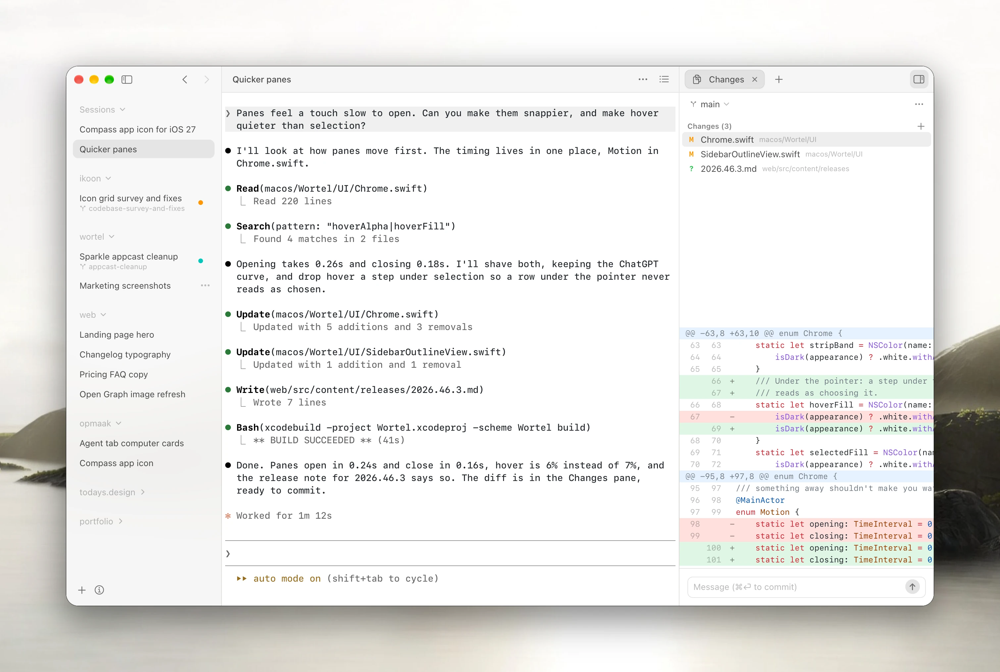

# Wortel

**A native macOS terminal your agents can live in.**

Wortel is a minimal, performance-first macOS terminal built on
[Ghostty](https://ghostty.org)'s real engine. Swift and AppKit, no web view,
nothing bolted underneath. Instead of tabs it has a sidebar of *named* sessions,
each one a shell in its own directory; point it at a repository and each agent
can have its own git worktree, with the diff of what it did sitting beside it.

Shells belong to a helper process rather than to the app, so quitting Wortel
closes a window instead of killing whatever your agents were in the middle of.

<picture>
  <source media="(prefers-color-scheme: dark)" srcset=".github/assets/hero-dark.webp">
  
</picture>

*One window: sessions named for what they are, an agent working in one of them,
and the diff of what it changed in the column beside it.*

[wortel.sh](https://wortel.sh) &middot; [download](https://wortel.sh/download) &middot;
[changelog](https://wortel.sh/updates) &middot; macOS 14 Sonoma or later, free,
signed and notarized

> **Naming.** "wortel" is Dutch for **root**, as in the root of a plant or the
> root shell. That is the intended metaphor, not "carrot".

---

## Status and licence

Wortel is free software, under the GNU General Public License, version 3 or
later:

```text
Copyright (C) 2026 Giel Cobben

This program is free software: you can redistribute it and/or modify it under
the terms of the GNU General Public License as published by the Free Software
Foundation, either version 3 of the License, or (at your option) any later
version.

This program is distributed in the hope that it will be useful, but WITHOUT ANY
WARRANTY; without even the implied warranty of MERCHANTABILITY or FITNESS FOR A
PARTICULAR PURPOSE. See the GNU General Public License for more details.
```

The licence text is [`LICENSE`](LICENSE). In short: you can use, study, change
and share it, and sell it too, and if you distribute a build, changed or not,
you pass on the same freedoms with its source.

Three things sit beside the GPL:

- **Third-party code keeps its own licence.** Ghostty, Sparkle, tree-sitter and
  the rest are listed in [`THIRD-PARTY-NOTICES.md`](THIRD-PARTY-NOTICES.md),
  with their notices. See [Third-party code](#third-party-code).
- **The name and the icon are not licensed by the GPL.** A build you publish
  uses its own name, icon and bundle id, and its own update feed and telemetry
  key. [`TRADEMARKS.md`](TRADEMARKS.md) says what to change.
- **The official builds** from [wortel.sh](https://wortel.sh) are free, for any
  use. The [Terms](https://wortel.sh/terms) cover downloading them and the
  site.

---

## Repository layout

Three self-contained deployables, and the docs that are true across all of
them. There is no shared build system and no workspace manager; work in one
rarely touches another.

| Directory | What it is | Deploys to |
| --- | --- | --- |
| [`macos/`](macos/) | The app. Swift + XcodeGen. **This is the product.** | Sparkle, via R2 |
| [`web/`](web/README.md) | The landing page. Astro, static. | wortel.sh |
| [`updates/`](updates/README.md) | The Worker serving the appcast and the signed archives. | updates.wortel.sh |
| [`docs/`](docs/) | Product, brand, voice, decisions, incidents, glossary. | |

`updates/` is separate from `web/` on purpose. The update channel must not be
able to go down with a bad landing-page build, and `release.sh --publish`
redeploys the landing page at the end of every release. That Worker changes
almost never.

Each directory documents itself. For the app, start with
[`macos/AGENTS.md`](macos/AGENTS.md): it says which file under
[`macos/docs/`](macos/docs/) to read before touching what. Those files are the
design record, and they are unusually detailed because most of the decisions in
this codebase were made against a measurement.

---

## Where things are written down

The repository is set up to be worked on by coding agents as much as by people,
so what would otherwise live in someone's head is in a file. Each one is short,
and each is read when it is needed rather than all at once.

| File | What it holds |
| --- | --- |
| [`AGENTS.md`](AGENTS.md) | The rules that hold everywhere, the commands, and what to read next. `CLAUDE.md` imports it, so every agent gets the same words. One more in each of `macos/`, `web/` and `updates/`. |
| [`DESIGN.md`](DESIGN.md) | How the app and the site are designed, and the numbers they are built from: colours, type, metrics, states, motion. |
| [`docs/product.md`](docs/product.md) | What Wortel is, what it believes, what it will not do, and how to tell whether a change belongs. |
| [`docs/brand.md`](docs/brand.md) | The name, the mark, and how it looks in the app and on the site. |
| [`docs/voice.md`](docs/voice.md) | How it writes: the site, the app, release notes, docs and commits. |
| [`docs/decisions.md`](docs/decisions.md) | What was decided and why, and what was tried and taken out. |
| [`docs/incidents.md`](docs/incidents.md) | The failures that left a rule behind. |
| [`docs/glossary.md`](docs/glossary.md) | What the words mean here. |
| [`macos/docs/`](macos/docs/) | The app: one file per area under `architecture/`, a design record per feature, building and debugging. |
| [`.agents/skills/`](.agents/skills/) | Procedures an agent can run: building and swapping the app, a throwaway test copy, releasing, writing a release note. |

---

## Building from source

### Requirements

- macOS 14 (Sonoma) or later to **run**
- **Xcode 26 or later** to build, for the macOS 26 SDK, and its Metal
  toolchain, which Xcode downloads separately:
  `xcodebuild -downloadComponent MetalToolchain`
- [XcodeGen](https://github.com/yonaskolb/XcodeGen): `brew install xcodegen`
- **[Zig](https://ziglang.org) at exactly the version in
  [`macos/GhosttyKit/zig.version`](macos/GhosttyKit/zig.version)**, to build
  Ghostty. `brew install zig` gives whatever Homebrew has today, which is the
  pinned version only until Zig moves on. Otherwise take that exact release
  from [ziglang.org/download](https://ziglang.org/download/), unpack it, and
  put its folder first on your `PATH`. The build refuses any other version.
- Node 22.18 or later, only for `web/` and `updates/`

The SDK requirement and the deployment target are deliberately far apart. The
app targets macOS 14 and runs there in full, but it imports `FoundationModels`
for two on-device features (naming a session from what is on its screen, and
drafting a commit message), and that framework only exists in the macOS 26 SDK.
Both are gated behind `@available(macOS 26.0, *)` and an Apple Intelligence
capability check, so on anything older they are simply absent.

### Build

```sh
git clone https://github.com/gielcobben/wortel.git
cd wortel/macos
scripts/build-ghostty.sh     # Ghostty from source: about five minutes, once
xcodegen generate
xcodebuild -project Wortel.xcodeproj -scheme Wortel -configuration Debug build
```

**Ghostty is built here, from source**, at the commit in
`macos/GhosttyKit/ghostty.ref` with Wortel's patches on top. The result is
cached in `~/Library/Caches/sh.wortel.ghostty` by a hash of its inputs, so a
second checkout costs a copy, and the script does nothing when the build is
already in place. Run it again after pulling a change to `macos/GhosttyKit/`.

**The `.xcodeproj` is generated and gitignored.** `macos/project.yml` is the
source of truth, so a fresh clone has no project file until you make one.
Re-run `xcodegen generate` after any change to `project.yml`, and after pulling
a change to it. The first build resolves twenty-odd Swift packages (Sparkle and
one tree-sitter grammar per supported language), so it needs a network and
takes a few minutes; later builds do not.

[`macos/docs/building.md`](macos/docs/building.md) has the rest: signing,
pinned packages, the test target and how to move Ghostty.

To run what you just built:

```sh
open "$(xcodebuild -project Wortel.xcodeproj -scheme Wortel -configuration Debug \
  -showBuildSettings 2>/dev/null \
  | awk -F' = ' '/ BUILT_PRODUCTS_DIR /{print $2; exit}')/Wortel.app"
```

Resolve `BUILT_PRODUCTS_DIR` rather than globbing DerivedData. A glob happily
matches several stale build directories and opens all of them.

### Your Debug build is its own app

A Debug build never touches the Wortel you have installed. It keeps its
sessions, its keeper (the process that holds the shells) and its `wortel`
socket in `~/Library/Application Support/Wortel Dev`, and it has its own
bundle id, `com.gielcobben.Wortel.dev`, so its settings are its own too. It
runs beside your installed Wortel, and quitting or rebuilding it never
touches your real sessions.

(The maintainer's daily Wortel is a Debug build, so a Mac can opt in to Debug
builds sharing the real folder. Leave that off on yours;
[`macos/docs/building.md`](macos/docs/building.md) has the details.)

A Release build is the real app: it uses the real folder unless you give it
another one with `WORTEL_DATA_DIR`.

### What a Debug build can't show

**Notifications.** An ad-hoc-signed build in DerivedData is not registered
with macOS's notification daemon. `UNUserNotificationCenter` reports
`granted`, accepts every post without error, and displays nothing. Showing
one needs a signed build in `/Applications`, which only the release script
makes, and that script quits Wortel and replaces your installed copy, so it is
not for contributors. If your change is about notifications, say so in the
pull request and it is checked in a signed build before it ships.

### `web/` and `updates/`

```sh
cd web && npm install && npm run dev        # http://localhost:4340
cd updates && npm install && npm test       # pure logic, no network
```

---

## Tests

```sh
./scripts/check.sh                                               # all three apps
cd macos
xcodebuild -project Wortel.xcodeproj -scheme WortelTests test    # the Swift suite, ~85s
cd ../updates && npm test                                        # the worker logic, <1s
```

The Swift target is deliberately **not hosted by the app**: hosting would launch
libghostty, Metal and a real shell in order to test pure functions. `project.yml`
instead lists the individual sources it exercises and compiles them into the test
bundle, which means **a new file needs listing in both targets**.

The bar for a source being testable here is that it works without the app shell,
and that constraint has shaped the code: it is why migration decisions stay out
of types that would drag AppKit in, and why the folder/leaf name split lives in
`SessionName` rather than on `Session`.

Most of these tests **use git itself as the oracle**. The commit ordering and the
graph layout are compared against real `git log --topo-order` and
`git log --graph` output from a fixture repository, because cheaply reproducing
those is the entire point of the code under test. `WortelTests/GitFixture.swift`
explains why its branches are deliberately long-lived: a tamer fixture passes
against known bugs.

There is no UI test coverage. For the app itself, "verify" still means building
it and using it.

### Benchmarks

```sh
cd macos
./bench/measure.sh     # cold launch + memory, Release only, in a throwaway copy
./bench/compare.sh     # throughput against every terminal you have installed
```

Current figures and the method are in
[`macos/bench/BENCHMARKS.md`](macos/bench/BENCHMARKS.md). The short version: the
Release bundle is about 7 MB and cold launch is 55 to 57 ms on Apple silicon (a
Debug build is several times larger and is not what these measure). Because Wortel embeds
Ghostty's VT parser, Metal renderer and glyph atlas, raw throughput is
Ghostty-class by construction; what these checks exist to prove is that the app
shell adds nothing on top.

---

## How the app is put together

One libghostty runtime. A list of sessions, each owning exactly one terminal
surface, each in one window.

- **`GhosttyRuntime`** owns the single libghostty process state and every C
  callback. Callbacks can arrive on libghostty's IO and render threads; each one
  copies its C-pointer data synchronously and then hops to the main thread.
- **`SurfaceView`** is the NSView hosting one surface, ported from Ghostty.app
  and trimmed. libghostty installs its own IOSurface-backed layer and renders
  from its own thread, so this view only does input forwarding (including the
  full `NSTextInputClient` IME dance) and geometry.
- **`SessionManager`** is the single source of truth for the session list and
  the selection, and the one path that lazily spawns a surface.
- **`TerminalHostViewController`** keeps every open session's view in the
  hierarchy and switches with `isHidden` and first-responder changes, so a
  switch rebuilds nothing and shows no flash. A terminal out of sight for a
  minute gives back its surface (about 70 MB), and one shown again is restored
  from the keeper's copy before it takes keys (`Sessions/Hibernation.swift`).
- **The keeper** (`Wortel/Keeper/`, `WortelKeeper/`) is a small helper process
  that owns the ptys. It knows nothing about terminals, git or rendering: it
  forks what it is told to fork and keeps reading when nobody is attached. Its
  one invariant is that exactly one process reads a pty at a time.

Two rules run through the whole codebase:

**The main thread, for everything the window shows.** Sessions, the sidebar
and the panels live there, and libghostty's callbacks hop to it at once. What
runs elsewhere is named and small: the code that reads ptys and sockets
(`PtyHost`, `ProgramStatusWatch`, the `wortel` command's server
`WortelCLIServer`, and in the keeper `KeeperServer`) runs on queues of its
own, so a terminal under load never waits for the main thread and the main
thread never waits on a socket; diff highlighting and background `git status`
are actors; and the telemetry client is an actor, because it touches the
network and must never make the terminal wait. The comment at the top of each
says what it shares and how.

**Cost tracks the window on screen, not the size of the repository.** The
terminal beside the git panel has to stay smooth on a monorepo, so: the commit
log is read in git's cheap default order and re-sorted in-process (asking git for
`--topo-order` makes it walk the entire history before printing a line, measured
at 870 ms against 20 ms, and `--max-count` does not bound it); diffs are parsed
off the main actor and capped; only expanded directories in the file tree are
listed, watched or `check-ignore`d. Each of those looks like a pointless detour
until you measure it on a large repository, and
[`macos/docs/architecture/git-panel.md`](macos/docs/architecture/git-panel.md)
records the numbers.

### What Wortel deliberately does not do

These are not gaps waiting to be filled. Returning "unhandled" for them is how
the design is enforced, and pull requests adding them are unlikely to land.
[`docs/product.md`](docs/product.md) has the reasoning and the questions a new
feature is held to.

- **No layout to build.** A window is a sidebar and, beside it, splits: parts
  with a row of tabs each. The window is arranged as it always was: Changes
  and Files beside the terminal (`⌥⌘B`) and a second terminal under it
  (`⌘J`) are splits that Wortel opens for you, where and as big as they
  always were. Any split can be split again (`⌘D`, `⇧⌘D`), and one is gone
  when its last tab closes. Nothing is hidden with its tabs kept: to have
  the window for one split, zoom it (`⇧⌘↩`). A split holds
  tabs, never another session: the sidebar of named sessions is where you
  switch work. The engine's own tab and split actions still return "unhandled".
  Splits are on the branch `flexible-panes` and not in a release yet
  ([`docs/decisions.md`](docs/decisions.md), 2026-11-26).
- **Almost nothing to configure, and no user config.** Settings (⌘,) holds
  the few switches that differ per person. Everything about the terminal
  itself is the bundled read-only `macos/Resources/wortel.conf`, and your real
  `~/.config/ghostty` is never read. To change fonts, theme or keybinds, edit
  that file and rebuild.
- **No inspector, and no search UI in the terminal.**
- **No per-agent integrations.** The `wortel` command is the whole interface, so
  anything that can run a command can drive the app.

---

## Keyboard

| Keys | Action |
| --- | --- |
| `⌘N` | New session (`⌥⌘N` at home) |
| `⌥⇧⌘N` / `⌘O` | New worktree session / open folder |
| `⇧⌘N` | New window: its own sidebar; drag a row between windows to move it |
| `⌥⌘R` | Rename session |
| `⌘W` / `⇧⌘W` | Close the tab you are in / close the session |
| `⌘1`…`⌘9` | Select session by position |
| `⌥⌘↑` / `⌥⌘↓` | Previous / next session |
| `⌃⌘[` / `⌃⌘]` | Back / forward through the sessions and tabs you were on |
| `⌘P` | Go to a session, or bring back an archived one |
| `⌘Y` | Find a prompt you typed to an agent |
| `⌥⇧⌘↓` | Jump to the next session waiting on you |
| `⌘B` | Show or hide the sidebar |
| `⌥⌘B` | Open Changes and Files beside the terminal, or close them |
| `⌘J` | Go to the terminal under the main one (making it if there is none), and back |
| `⇧⌘C` / `⇧⌘H` / `⇧⌘F` | Changes / History / Files (`⌃⇧G` is source control, on the one you used last) |
| `⌘T` | New terminal tab in the area you are in |
| `⌥⌘T` | New tab that asks what it should be: a terminal, a browser, Changes, History or Files |
| `⌘D` / `⇧⌘D` | Split right / split down: a new terminal in a split beside or under the one you are in |
| `⇧⌘↩` / `⌃⌘=` | Show one split alone, and all of them again / make the splits equal |
| `⌃⌥⌘` and an arrow | Focus the split in that direction |
| `⌃⌘` and an arrow | Move the tab in front to the split in that direction |
| `` ⌃⇧` `` | New terminal below |
| `⇧⌘B` | New browser tab |
| `⇧⌘T` | Reopen closed tab |
| `⌃Tab` / `⌃⇧Tab` | Next / previous tab (also `⌥⌘→` / `⌥⌘←`) |
| `⌘]` / `⌘[` | Focus the next / previous area |
| `⌘L` / `⌘R` | Browser: address field / reload |
| `⌘F`, `⌘G` | Find in a file, next match |
| `⌘K` | Clear the terminal |
| `⌘+` / `⌘-` / `⌘0` | Font size |
| `⇧⌘A` | Select all (the whole scrollback) |
| `⌘/` | This list |

The full list, and which app each one is borrowed from, is in
[`macos/docs/shortcuts.md`](macos/docs/shortcuts.md).

`⌘A` is deliberately *not* select-all: it is bound in `wortel.conf` to clear the
input line, which is why select-all lives on `⇧⌘A`. The menu is authoritative for
key equivalents (AppKit scans them on every keypress, so it is kept small), and
it interacts with `wortel.conf`'s keybinds. **When adding or moving a shortcut,
check both files.**

With a preview window in front, `⌘1` / `⌘2` / `⌘3` switch it between diff, source
and rendered Markdown. The shortcut physically moves between menus rather than
being duplicated, because `performKeyEquivalent` stops at the first matching item
and swallows the event if that item validates as disabled.

---

## The `wortel` command

A Unix socket the CLI speaks JSON at. **There is nothing to install:** the binary
ships inside the app bundle and every shell Wortel spawns gets its directory on
`PATH`, so the command exists inside a session and nowhere else.

```sh
wortel open README.md                       # open a file in a tab
wortel open report.html                     # an .html file opens as a page, and reloads
wortel new --cwd ~/Developer/lijn           # a session there
wortel new --branch fix/1482 --from main    # a session in its own worktree
wortel rename "css rules"                   # rename the session you are in
wortel notify "Build finished"              # raise attention on this session
wortel list                                 # every open session, and what it is doing
wortel send api "run the tests" --enter     # type into another session
wortel wait api --idle                      # until that session goes quiet
```

Two decisions shape it: it **never steals focus** (windows are ordered front, the
app is never activated, so a hook firing behind your back cannot take your
keyboard), and **a command means the session it was run in**, read from
`$WORTEL_SESSION_ID` rather than passed as an argument.

Full guide: [`macos/docs/wortel-command.md`](macos/docs/wortel-command.md).
Design record: [`macos/docs/cli.md`](macos/docs/cli.md).

---

## Contributing

[`CONTRIBUTING.md`](CONTRIBUTING.md) says how to build, test and send a
change, and which rules a pull request is held to. Security problems go
privately, as [`SECURITY.md`](SECURITY.md) describes, never in a public issue.

---

## Releasing

Maintainer only. It needs the Developer ID, the update signing key and the
Cloudflare account, and nothing in a contribution depends on it.

```sh
cd macos
./scripts/release.sh --publish
```

That derives a CalVer version, builds, signs, notarizes, staples, EdDSA-signs a
zip, regenerates the Sparkle appcast, uploads to the `wortel-updates` R2 bucket
and redeploys the landing page. Versions are `<ISO-week-year>.<ISO-week>.<nth
release that week>`, derived from the date, so there is no version to choose.

**Publishing requires a release note.** One Markdown file per release in
`web/src/content/releases/`, *named for the version* (`2026.33.1.md`). It is the
only place release notes are written and it feeds both the public changelog and
the notes Sparkle embeds in the in-app update dialog. The check runs before
anything is built.

Note `--no-install`, which exists for a specific hazard: a release is often cut
from a shell running inside Wortel, and the install step removes
`/Applications/Wortel.app` before copying its replacement. The process that
keeps every session's shell alive runs out of that bundle, and so does the
`wortel` command on every session's `PATH`. Publish with `--no-install` and take
the update through Wortel ▸ Check for Updates…, like any other user.

---

## Privacy

Wortel reports anonymous feature usage, opt-out, off in one switch (the **ⓘ**
at the bottom of the sidebar, or **Wortel ▸ Settings…**) and disclosed on first
launch. It also
honours `DO_NOT_TRACK`, never reports from a Debug build, and never reports from
a locally built Release.

**Nothing about your work leaves the machine.** The events are a closed list you
can read in one screen ([`macos/Wortel/Telemetry/TelemetryEvent.swift`](macos/Wortel/Telemetry/TelemetryEvent.swift)),
and no case in it takes a `String`. That is the mechanism, not a promise: "could
this leak a repository name" is a question the compiler answers rather than one
anybody has to audit. Adding a `String` parameter to an event is the change that
breaks it, and if a question needs a value that is not a small closed set, the
answer is a bucket or no event at all.

Separately, `updates.wortel.sh` counts downloads and update checks, and Sparkle
puts the running version in its User-Agent. That covers every install including
those with the app's own reporting turned off, which is exactly why it has to be
disclosed. See [`updates/README.md`](updates/README.md) and
[`macos/docs/telemetry.md`](macos/docs/telemetry.md).

---

## Third-party code

| What | Used for |
| --- | --- |
| [libghostty](https://ghostty.org) via [libghostty-spm](https://github.com/Lakr233/libghostty-spm) | The terminal engine: VT parser, Metal renderer, glyph atlas, IO threads |
| [Sparkle](https://github.com/sparkle-project/Sparkle) | Auto-update |
| [swift-tree-sitter](https://github.com/tree-sitter/swift-tree-sitter) + 18 grammars | Syntax highlighting in diffs and previews |

`macos/Resources/ghostty/` carries Ghostty's shell integration scripts and
terminfo, shipped as folder references. `macos/Grammars/` vendors a few
tree-sitter external scanners whose upstream packaging does not build under
Xcode; [`macos/Grammars/README.md`](macos/Grammars/README.md) explains which and
why.

Each of these is under its own licence, and none of it is relicensed by
Wortel's. [`THIRD-PARTY-NOTICES.md`](THIRD-PARTY-NOTICES.md) lists every
component in the app and in this repository, with its licence and the full
notice it asks for: Ghostty and the libraries and fonts its build compiles into
libghostty, the shell integration (three of whose scripts are GPL, from Kitty),
the themes, Sparkle, tree-sitter and its grammars, herdr's word lists, and the
site's photos. The app ships a copy of it, and of `LICENSE`, in
`Contents/Resources`. When a dependency is added or a pin moves, update it in
the same commit.
